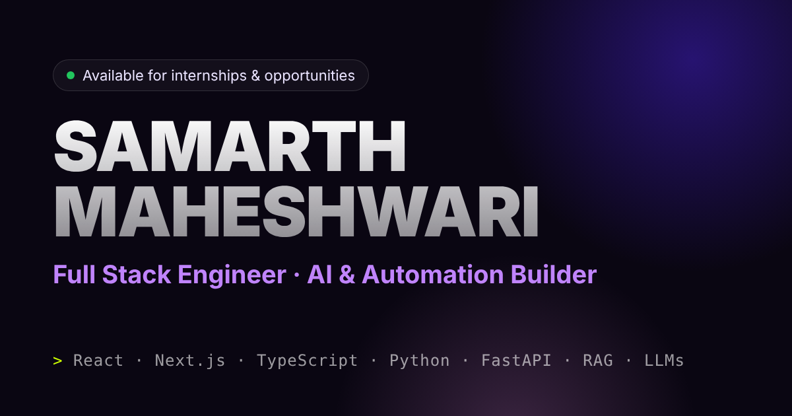

# Samarth Maheshwari — Portfolio

**Full Stack Engineer · AI & Automation Builder** · Indore, India

🔗 Live: https://samarth-portfolio-kappa-virid.vercel.app



## What's inside

| Part | Tech | Notes |
|------|------|-------|
| Site | HTML, CSS, vanilla JS, Three.js (WebGL fluid background), Lenis | Single static page deployed on Vercel. No build step. |
| AI chat ("Ask my AI") | Cloudflare Worker (TypeScript) in [`samarth-ai-worker/`](samarth-ai-worker) | Answers recruiter questions from a curated knowledge file, with rate limiting, input validation, response caching and a static fallback when the model is down. |
| Contact form | FormSubmit (AJAX) | Client-side validation + honeypot spam trap. |

## Featured projects

- **JARVIS** — Windows AI desktop assistant with a 5-model LLM fallback chain (cloud → local). [Repo](https://github.com/samarth-maheshwari-dev/Personal-Ai-ASISTANT)
- **Project Aion** — RAG + knowledge-graph assistant for industrial documents (ET AI Hackathon 2026). [Repo](https://github.com/samarth-maheshwari-dev/Aion-project-for-Economic-Times)
- **SnapTrace AI** — photo-first AI lost-and-found app, shipped live at IntelliAI Arena 2026. [Live](https://snaptrace-ai.vercel.app)

## Run locally

```bash
# site
npx serve .            # or: python -m http.server 3000

# AI worker (needs OPENCODE_API_KEY set via `wrangler secret put` / .dev.vars)
cd samarth-ai-worker
npm install
npm run dev            # http://127.0.0.1:8787 — the site auto-uses this on localhost
```

## Deploy

- **Site:** push to `main` → Vercel deploys automatically.
- **Worker:** `cd samarth-ai-worker && npm run deploy`

## Contact

[LinkedIn](https://www.linkedin.com/in/samarth-maheshwari-71a152326/) · [GitHub](https://github.com/samarth-maheshwari-dev) · samarthmaheshwari54321@gmail.com
